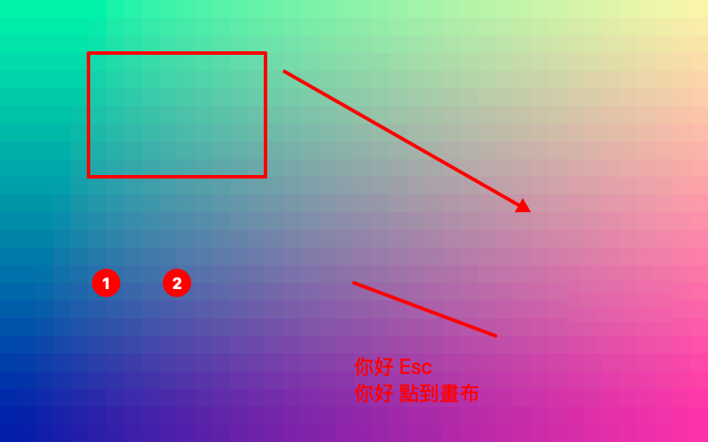
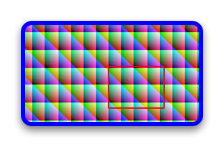

# TracePixels

**A fast, native screenshot and annotation tool for macOS.**

Capture a region, a window, or a whole display with one shortcut. Mark it up with arrows, text, step markers, highlights, and *irreversible* blur or pixelation. Then copy, save, drag, or share the result. Everything stays on your Mac.

TracePixels lives in the menu bar, is written entirely in Swift on Apple's own frameworks, and has no network code at all.

## Highlights

- **Three capture modes.** Drag a region, click a window (even one that is partly covered), or grab a whole display. Captures are taken at your display's native pixel resolution.
- **Precise region selection.** A live readout shows the cursor position and selection size, and a magnifier helps you land on the exact pixel.
- **Ten annotation tools plus crop.** Arrow, line, rectangle, ellipse, pen, highlighter, text, numbered step markers, blur, and pixelate.
- **Annotations stay editable.** Every mark is its own object: select it, move it, resize it, restyle it, reorder it, or delete it, with unlimited undo and redo.
- **Redaction you can trust.** Blur and pixelate rebuild the pixels at export time, so the hidden content cannot be recovered from the exported image.
- **Non-destructive by design.** Your original capture is never modified. Cropping, resizing, borders, shadows, and rounded corners are applied only when you export.
- **A library of past captures.** Every capture is saved automatically. Reopen any of them later and keep editing; nothing is ever deleted unless you delete it.
- **Private by default.** No accounts, no cloud, no analytics, no network access.
- **Made for the Mac.** Light and dark appearance, English and Traditional Chinese, VoiceOver support, and keyboard access to every tool and action.

## What the output looks like

The two images below are rendered by TracePixels' exporter from a synthetic test image (not real screenshots), so they show exactly what an export contains.

| Annotations: rectangle, arrow, step markers, pen, text | Crop + 50% resize + border + shadow + rounded corners |
|:--:|:--:|
|  |  |

## Requirements

- macOS 14 (Sonoma) or later
- Xcode 16 or later to build from source (developed with Xcode 27.1 on macOS 26)
- The **Screen & System Audio Recording** permission, requested the first time you capture

## Install

There is no packaged release yet, so you build TracePixels from source.

```bash
git clone https://github.com/flight-tom/TracePixels.git
cd TracePixels

xcodebuild -project TracePixels.xcodeproj -scheme TracePixels \
  -configuration Release -destination 'platform=macOS' \
  -derivedDataPath build/DerivedData build

open build/DerivedData/Build/Products/Release/TracePixels.app
```

You can also open `TracePixels.xcodeproj` in Xcode and press **Run**. To keep the app, drag `TracePixels.app` into your Applications folder.

> **Note:** builds are signed ad hoc ("Sign to Run Locally"). Because the signature changes with every rebuild, macOS may ask you to grant the Screen Recording permission again after you rebuild.

### First run

TracePixels is a menu bar app: it has **no window and no Dock icon** until you capture something or open the library. After launching, look for the viewfinder icon (a camera frame) at the right side of the menu bar.

1. Press **⌃⇧4** (or choose **Capture Region** from the menu bar icon).
2. macOS asks for the **Screen & System Audio Recording** permission. Open **System Settings › Privacy & Security › Screen & System Audio Recording**, switch **TracePixels** on, then quit and relaunch TracePixels.
3. Press **⌃⇧4** again and drag over something on your screen.

Until you grant the permission, TracePixels shows an explanation window instead of producing blank images.

## Using TracePixels

### 1. Capture

Start a capture with the global shortcut **⌃⇧4**, or from the menu bar icon. A dimmed overlay appears on every display with a small mode bar at the top.

| Mode | Key | How |
|------|:---:|-----|
| Region | `R` | Drag a rectangle and release the mouse to capture. A readout shows the position and size, and a magnifier follows the cursor. |
| Window | `W` | Hover a window to highlight it, then click. The whole window is captured, even if other windows cover part of it. |
| Full Screen | `F` | Click on the display you want to capture. |
| Cancel | `Esc` | Leaves the overlay without saving or copying anything. |

You can switch modes at any time with the keys above or with the buttons in the mode bar. A region selection is limited to the display where you started dragging.

When a capture finishes, TracePixels (depending on your settings) opens it in the editor, copies it to the clipboard, and/or saves it to a folder. Either way it is added to your library automatically.

### 2. Annotate

Each capture opens in its own editor window: a toolbar on top, the canvas in the middle, and an inspector for color, thickness, font, fill, and other options on the right.

| Tool | Key | Notes |
|------|:---:|-------|
| Select | `V` | Click to select, drag to move, drag the handles to resize, Shift-click to add to the selection. |
| Arrow | `A` | Hold **Shift** to snap to 45° steps. |
| Line | `L` | Hold **Shift** to snap to 45° steps. |
| Rectangle | `R` | Hold **Shift** for a square. Can be outlined or filled. |
| Ellipse | `O` | Hold **Shift** for a circle. Can be outlined or filled. |
| Pen | `P` | Freehand drawing. |
| Highlighter | `H` | A wide, translucent stroke. |
| Text | `T` | Click (or drag a box) and type. Press `Esc` or click elsewhere to finish. Double-click text with the Select tool to edit it again. |
| Step Marker | `N` | Click to drop numbered markers: 1, 2, 3… Numbers are never renumbered automatically. |
| Blur | `B` | Drag over what you want to hide. Adjust the strength in the inspector. |
| Pixelate | `X` | Same as Blur, with a mosaic look. |
| Crop | `C` | Drag the area to keep. Dimmed areas are excluded from exports. Clear or undo it at any time. |

**Editing tips**

- **Undo / redo** with `⌘Z` and `⇧⌘Z`. There is no limit, and one drag or slider change is one undo step.
- **Delete** the selected annotation with `⌫`. Nudge it with the arrow keys (1 px, or 10 px with **Shift**).
- **Reorder** overlapping annotations with `⌥⌘]` (to front), `⌘]` (forward), `⌘[` (backward), and `⌥⌘[` (to back).
- **Zoom** with `⌘+`, `⌘-`, and `⌘0` (fit to window), or pinch on a trackpad. Scroll to pan.
- **Style** is remembered per tool: the next arrow you draw uses the color and thickness you last picked for arrows.

> **About redaction.** Blur and pixelate are applied to everything beneath them, including other annotations, and are baked into exported images by rebuilding the pixels from coarse tiles (a minimum of 8 px). The original capture inside your library is kept unmodified so you can still edit it; only the *exported* image is irreversible.

### 3. Export and share

| Action | How |
|--------|-----|
| Copy to the clipboard | `⌘C`, or the copy button in the toolbar |
| Save as PNG or JPEG | `⇧⌘S` (**Save As…**), or the save button |
| Drag into another app | Drag the **Drag to Export** handle in the toolbar into a chat, document, or folder |
| Share | The **Share** button in the toolbar, or **File › Share…** |

Before exporting you can also:

- **Resize** the output with **View › Resize Output…** (`⌥⌘I`). Resizing affects only the exported image.
- **Add a border, a drop shadow, and rounded corners** from the inspector's **Finishing** section.
- Check the **Export Preview** in the inspector, which shows the final result including crop, resize, and finishing.

Saved files are named `TracePixels yyyy-MM-dd HH.mm.ss.png` (or `.jpg`), with a number added if the name already exists. The default folder is `~/Pictures/TracePixels`, and you can change it in Settings.

### 4. The library

Every capture is saved automatically, and your edits are saved continuously, so closing an editor window never loses work and there is no "unsaved" state.

- Open the library with **⇧⌘L**, or **Open Library…** from the menu bar icon.
- Captures appear as thumbnails, newest first. **Double-click** one to reopen it with all of its annotations still editable.
- Press `⌫` or use the context menu to delete a capture. TracePixels always asks for confirmation first.
- TracePixels **never deletes captures on its own**. To reclaim space, use **Settings › Library › Clean Up…** to remove captures older than a number of days you choose.

### 5. Settings

Open **Settings…** with `⌘,` or from the menu bar icon.

| Tab | What you can change |
|-----|---------------------|
| **General** | Launch at login (off by default). |
| **Capture** | The global capture shortcut, what happens after a capture (open in editor, copy to clipboard, save to the default folder), whether to include the mouse cursor, whether to include the window shadow when capturing a window, and the default save folder. |
| **Export** | The default format (PNG or JPEG) and the JPEG quality (default 90%). |
| **Library** | How much space the library uses, and manual clean-up of old captures. |

## Keyboard shortcuts

| Shortcut | Action |
|----------|--------|
| `⌃⇧4` | Start a capture (global; configurable in Settings) |
| `⌃⌥⌘R` / `⌃⌥⌘W` / `⌃⌥⌘F` | Capture region / window / full screen (from the **File** menu while TracePixels is active) |
| `⇧⌘L` | Open the library |
| `⌘,` | Settings |
| `⌘Z` / `⇧⌘Z` | Undo / redo |
| `⌘C` | Copy the image |
| `⇧⌘S` | Save As… |
| `⌫` | Delete the selected annotation |
| `⌘+` / `⌘-` / `⌘0` | Zoom in / zoom out / fit to window |
| `⌥⌘I` | Resize Output… |
| `⌥⌘]` / `⌘]` / `⌘[` / `⌥⌘[` | Bring to front / forward / backward / send to back |
| `V A L R O P H T N B X C` | Select the tool (while the canvas has focus) |
| `Esc` | Cancel a capture · deselect and return to the Select tool · finish editing text |
| `⌘W` | Close the window |

## Where your data lives

| What | Where |
|------|-------|
| Library | `~/Library/Application Support/TracePixels/Library/` |
| Default save folder | `~/Pictures/TracePixels/` |
| Settings | The standard macOS preferences for `com.tracepixels.app` |

Each capture is a folder named `<UUID>.tracepixelscapture` containing `image.png` (the original, never modified), `document.json` (annotations and settings), and `thumbnail.jpg`. The format is documented in [`contracts/library-format.md`](specs/001-screenshot-capture-annotation/contracts/library-format.md).

## Privacy

TracePixels contains no networking code and links no networking frameworks. Captures, annotations, and settings stay on your Mac unless you explicitly copy, save, drag, or share an image yourself.

## Troubleshooting

**Nothing appears when I launch the app.**
That is expected: TracePixels is a menu bar app. Look for the viewfinder icon on the right side of the menu bar, or press `⌃⇧4`.

**My captures are blank, or I see the permission window.**
Grant **TracePixels** access in **System Settings › Privacy & Security › Screen & System Audio Recording**, then quit and relaunch it. If you rebuilt the app, remove the old TracePixels entry from that list and add it again, because ad-hoc signatures change with every build.

**The capture shortcut does nothing, or Settings warns about a conflict.**
Another app is using `⌃⇧4`. Pick a different combination in **Settings › Capture**. A shortcut must include at least one of ⌃, ⌥, or ⌘.

**Video from a streaming service or DRM-protected app is black in the capture.**
macOS withholds protected content from screen capture, and apps cannot detect this.

**Xcode's console prints `com.apple.linkd.autoShortcut` errors when I run the app.**
These come from the system Shortcuts service while it tries to register the app. TracePixels does not use App Intents, and the messages did not affect the app in our testing.

## Building and testing

The project has two layers: **`TracePixelsCore`**, a local Swift package with no UI dependencies (the annotation model, undo history, renderer, redaction, export, and library), and the **`TracePixels`** app target (AppKit and SwiftUI).

```bash
# Core logic tests: no screen needed, the fastest feedback loop (130 tests)
cd Packages/TracePixelsCore && swift test

# Run a single test class
cd Packages/TracePixelsCore && swift test --filter RedactionTests

# Rendering performance in Release as well as Debug
cd Packages/TracePixelsCore && swift test -c release --filter PerformanceTests

# App unit tests (23 tests)
xcodebuild -project TracePixels.xcodeproj -scheme TracePixels \
  -destination 'platform=macOS' -derivedDataPath build/DerivedData test
```

```text
TracePixels.xcodeproj/      Xcode project (file-system synchronized groups)
TracePixels/                App: capture, editor, library, settings
TracePixelsTests/           App unit tests (editor view model, main menu)
Packages/TracePixelsCore/   Core package: model, undo, rendering, redaction, export, library
specs/                      Specification, plan, tasks, contracts, and verification notes
.specify/                   Spec Kit configuration and the project constitution
```

### Project status

TracePixels is an early release. The core logic (model, undo, rendering, redaction, export, library, geometry) is covered by automated tests, and a rendering budget of 33 ms per frame for a 5K image with 100 annotations is enforced by a test. The parts that need a real screen or a real person, such as the capture overlay, capturing a window that is partly covered, the global shortcut, drag-and-drop, sharing, and VoiceOver, have **not** been fully verified yet. See [`verification.md`](specs/001-screenshot-capture-annotation/verification.md) for exactly what has and has not been checked, and [`quickstart.md`](specs/001-screenshot-capture-annotation/quickstart.md) for the manual test procedure.

Known limitations: builds are ad-hoc signed (distribution would need a Developer ID signature and notarization), the app is not sandboxed, and the minimum supported macOS is 14.

### How it was built

TracePixels was developed with [Spec Kit](https://github.com/github/spec-kit)'s Spec-Driven Development workflow, assisted by Claude Code. The feature specification, plan, research notes, and task list live in [`specs/001-screenshot-capture-annotation/`](specs/001-screenshot-capture-annotation/), and the project's governing principles are in [`.specify/memory/constitution.md`](.specify/memory/constitution.md). Guidance for working in the codebase is in [`CLAUDE.md`](CLAUDE.md). Those documents are written in Traditional Chinese.

## License

Copyright (C) 2026 Tom Tang.

TracePixels is free software, released under the **GNU Lesser General Public License, version 3** (SPDX: `LGPL-3.0-only`). The full text is in [`LICENSE`](LICENSE). The LGPL is a set of additional permissions on top of the **GNU General Public License, version 3**, so that text is included as well in [`COPYING`](COPYING).

In short (this is a summary, not legal advice; the license text is what governs): you may use, study, modify, and redistribute TracePixels, and you may use its code, such as the `TracePixelsCore` package, as a library inside other programs, including proprietary ones, as long as you follow the LGPL's conditions. Those conditions include sharing changes you make to TracePixels itself under the same license and letting users replace the LGPL-covered part with a modified version.
